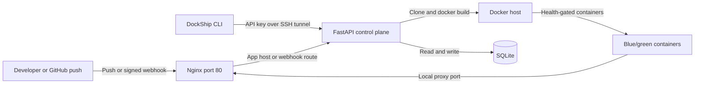

# DockShip

[](https://github.com/RAJPRASHUL/DockShip/actions/workflows/ci.yml)

DockShip is a self-hosted deployment control plane for trusted GitHub
repositories. It validates applications, clones and builds Docker images,
performs health checks, switches traffic through blue-green releases, and
supports rollback.

## Table of contents

- [Architecture](#architecture)
- [What is included](#what-is-included)
- [Prerequisites](#prerequisites)
- [Local quickstart](#local-quickstart)
- [Configure secrets](#configure-secrets)
- [Run the API](#run-the-api)
- [DockShip CLI](#dockship-cli)
- [Application contract](#application-contract)
- [API reference](#api-reference)
- [GitHub webhook](#github-webhook)
- [Blue-green deployments](#blue-green-deployments)
- [Metrics](#metrics)
- [AWS deployment](#aws-deployment)
- [GitHub Actions](#github-actions)
- [Backups and cleanup](#backups-and-cleanup)
- [Demo script](#demo-script)
- [Project layout](#project-layout)
- [Troubleshooting](#troubleshooting)

## Architecture



The control plane runs as a host process under systemd on production. It
needs direct access to Docker and Nginx, so it is not currently running as a
containerized service.

GitHub Actions:

```text
lint -> pytest -> Docker build -> Trivy scan -> GHCR push -> SSH host restart
```

## What is included

- Public `/health` endpoint.
- API-key authentication for management endpoints.
- HMAC-SHA256 GitHub webhook verification.
- GitHub delivery-ID deduplication.
- Strict application name, branch, and GitHub repository validation.
- Two-port allocation for blue and green releases.
- Real Docker build timeout and container health gate.
- Atomic Nginx configuration replacement with validation and rollback.
- Blue-green switching, drain delay, rollback, and pending-release recovery.
- Per-app deployment serialization and a global build semaphore.
- Container CPU, memory, and log limits.
- Typer CLI for the complete application lifecycle.
- Terraform AWS EC2, Nginx, IAM, S3 backup, Elastic IP, and systemd files.
- GitHub Actions CI/CD for testing, scanning, publishing, and SSH deployment.
- Prometheus deployment metrics.
- SQLite backup and Docker image cleanup scripts.

## Prerequisites

### Local development

- Windows with PowerShell or Linux/WSL.
- Python 3.12 or newer.
- [`uv`](https://docs.astral.sh/uv/getting-started/installation/) package manager.
- Docker Desktop or Docker Engine.
- Git.
- Nginx only if testing real host routing.

### AWS deployment

- AWS account with a budget or billing alert.
- EC2 key pair.
- AWS CLI and Terraform 1.10 or newer.
- An IAM principal with permissions for EC2, IAM, S3, EIP, and security groups.
- A GitHub repository and an SSH key for the `dockship` account.

> Deploying AWS infrastructure may incur charges. Public IPv4 addresses and
> running EC2 instances are not free in every account type. Run
> `terraform destroy` when the environment is no longer needed.

## Local quickstart

From the repository root:

```powershell
uv sync
Copy-Item .env.example .env
```

Do not keep `change-me` in `.env`. Generate real values by following
[Configure secrets](#configure-secrets).

Create the database and start the API:

```powershell
uv run uvicorn dockship.main:app --host 127.0.0.1 --port 8000 --reload
```

Open:

```text
http://127.0.0.1:8000/health
http://127.0.0.1:8000/docs
```

Verify authentication:

```powershell
# Should return 401
Invoke-RestMethod "http://127.0.0.1:8000/apps"

$apiKey = (Get-Content .env |
    Where-Object { $_ -like "DOCKSHIP_API_KEY=*" }).Substring(17)

Invoke-RestMethod `
  "http://127.0.0.1:8000/apps" `
  -Headers @{ "X-API-Key" = $apiKey }
```

Run tests and lint:

```powershell
uv run pytest -q tests
uv run ruff check src tests
```

## Configure secrets

DockShip has two application secrets.

### `DOCKSHIP_API_KEY`

This is a key you choose for your management API. It protects:

- `/apps`
- `/deployments/{deployment_id}`
- `/metrics`
- Deployment and rollback operations

Create it locally in PowerShell:

```powershell
$bytes = New-Object byte[] 32
[Security.Cryptography.RandomNumberGenerator]::Create().GetBytes($bytes)
[Convert]::ToBase64String($bytes)
```

Copy the generated value into `.env`:

```dotenv
DOCKSHIP_API_KEY=<generated-api-key>
GITHUB_WEBHOOK_SECRET=<generated-webhook-secret>
DB_PATH=./dockship.db
```

### `GITHUB_WEBHOOK_SECRET`

Choose a second secret for GitHub webhook signature validation.

Generate it the same way, then:

1. Open the application repository on GitHub.
2. Go to **Settings > Webhooks > Add webhook**.
3. Set **Content type** to `application/json`.
4. Set **Secret** to the exact `GITHUB_WEBHOOK_SECRET` value.
5. Select **Pushes** as the event.
6. Save the webhook.

The GitHub webhook endpoint is:

```text
/webhook/github
```

GitHub sends `X-Hub-Signature-256`; DockShip verifies the raw request body.

### GitHub Actions secrets

GitHub supplies `GITHUB_TOKEN` automatically to Actions with the permissions
configured in the workflow.

Create these in
**Repository or production environment: Settings > Secrets and variables > Actions**:

| Secret | Where to get it |
| --- | --- |
| `EC2_HOST` | Elastic IP displayed in the EC2 console |
| `EC2_SSH_KEY` | Private key belonging to the EC2 key pair |

`EC2_SSH_KEY` must contain the private key, including PEM headers, not the EC2
key-pair name.

Never commit `.env`, PEM files, AWS credentials, webhook secrets, or API keys.

## Run the API

The API is available on port `8000` locally. The public endpoints are
`/health` and `/webhook/github`; management endpoints require
`X-API-Key`.

Example:

```powershell
$apiKey = "<DOCKSHIP_API_KEY>"
Invoke-RestMethod "http://127.0.0.1:8000/apps" `
  -Headers @{ "X-API-Key" = $apiKey }
```

The OpenAPI documentation is available at:

```text
http://127.0.0.1:8000/docs
```

## DockShip CLI

Log in and save the local configuration:

```powershell
uv run dockship login --server http://localhost:8000 --api-key "<DOCKSHIP_API_KEY>"
```

The CLI stores configuration at `~/.dockship.json`. On Unix systems it writes
the file with `0600` permissions.

Available commands:

```text
dockship login
dockship register
dockship list
dockship deploy
dockship logs
dockship rollback
dockship status
dockship delete
```

Examples:

```powershell
uv run dockship register hello `
  https://github.com/OWNER/hello-app `
  --branch main `
  --health-path /health

uv run dockship deploy hello
uv run dockship logs hello --tail 100
uv run dockship rollback hello
uv run dockship status <deployment-id>
uv run dockship list
uv run dockship delete hello
```

For production, open an SSH tunnel:

```bash
ssh -N -L 8000:127.0.0.1:8000 ubuntu@<elastic-ip>
```

Then use `http://localhost:8000` from the CLI on the local machine.

## Application contract

Only trusted repositories should be registered because the Dockerfile runs on
the DockShip host.

App names must match:

```text
^[a-z][a-z0-9-]{1,30}[a-z0-9]$
```

The reserved name `platform` cannot be registered.

Each repository must:

- contain a Dockerfile;
- listen on the `PORT` environment variable;
- expose `/health` or another configured HTTP health path;
- return HTTP `200` from the health endpoint;
- use an HTTPS GitHub repository URL.

Example application:

```text
examples/hello-app/
```

The example Dockerfile starts FastAPI on `${PORT}`.

## API reference

| Method | Path | Authentication | Description |
| --- | --- | --- | --- |
| `GET` | `/health` | None | Service health |
| `GET` | `/apps` | `X-API-Key` | List registered applications |
| `POST` | `/apps` | `X-API-Key` | Register an application |
| `POST` | `/apps/{name}/deploy` | `X-API-Key` | Start a manual deployment |
| `POST` | `/apps/{name}/rollback` | `X-API-Key` | Roll back to `previous_sha` |
| `GET` | `/apps/{name}/logs` | `X-API-Key` | Read active container logs |
| `DELETE` | `/apps/{name}` | `X-API-Key` | Stop containers and remove the app |
| `GET` | `/deployments/{deployment_id}` | `X-API-Key` | Read deployment status |
| `GET` | `/metrics` | `X-API-Key` | Prometheus metrics |
| `POST` | `/webhook/github` | GitHub HMAC signature | Receive push events |

Example app registration payload:

```json
{
  "name": "hello",
  "repo_url": "https://github.com/OWNER/hello-app",
  "branch": "main",
  "health_path": "/health"
}
```

## GitHub webhook

GitHub webhook settings:

| Setting | Value |
| --- | --- |
| Payload URL | `http://platform.<elastic-ip>.nip.io/webhook/github` |
| Content type | `application/json` |
| Secret | Exact `GITHUB_WEBHOOK_SECRET` value |
| Events | Pushes only |

On a local machine, use a tunnel such as smee.io or expose a local server with
an existing tunnel tool. Each GitHub delivery ID is recorded once, preventing
the same delivery from triggering duplicate deployments.

Malformed or signed payloads with invalid structure return HTTP `400`.
Wrong signatures return HTTP `401`.
Ping events return `{"msg":"pong"}`.

## Blue-green deployments

Each app receives one blue port and one green port.

Release flow:

1. Lock the app to serialize deployments and rollbacks.
2. Clone and build under a global build semaphore.
3. Run the inactive container color.
4. Wait for `/health` to return HTTP `200`.
5. Atomically replace and validate the Nginx configuration.
6. Reload Nginx.
7. Wait for the configured drain period.
8. Stop the previous container.
9. Update `current_sha`, `previous_sha`, and `active_color`.

If health checks or Nginx validation fail, the old release remains active.
Old containers and deployments are cleaned on unhealthy or failed releases.

## Metrics

`/metrics` exposes:

- `dockship_deployments_total{status}`
- `dockship_deploy_duration_seconds`
- `dockship_apps_active`

The endpoint requires `X-API-Key`. Scrape it over the SSH tunnel or through a
private Prometheus instance.

Example:

```powershell
$apiKey = "<DOCKSHIP_API_KEY>"
Invoke-WebRequest `
  "http://127.0.0.1:8000/metrics" `
  -Headers @{ "X-API-Key" = $apiKey }
```

## AWS deployment

Create an AWS budget or billing alert before provisioning.

### 1. Create the Terraform state bucket

From a machine with AWS credentials:

```bash
cd infra
bash bootstrap.sh
```

The script prints a unique S3 bucket name. Put that exact name in
`infra/main.tf`:

```hcl
backend "s3" {
  bucket       = "dockship-tfstate-REPLACE_ME"
  key          = "prod.tfstate"
  region       = "ap-south-1"
  use_lockfile = true
}
```

### 2. Initialize and provision

Replace `my-key-pair` with the EC2 key-pair name:

```bash
cd infra
terraform init
terraform plan -var="key_name=my-key-pair"
terraform apply -var="key_name=my-key-pair"
```

Terraform outputs:

- `public_ip`
- `backup_bucket`
- an SSH command

### 3. Configure the server

After first boot:

```bash
ssh ubuntu@<elastic-ip>
sudo -iu dockship
git clone <repository-url> /opt/dockship
cd /opt/dockship
uv sync --frozen
```

Create `/opt/dockship/.env` with production secrets:

```dotenv
DOCKSHIP_API_KEY=<production-api-key>
GITHUB_WEBHOOK_SECRET=<production-webhook-secret>
DB_PATH=/var/lib/dockship/dockship.db
NGINX_CONF_DIR=/etc/nginx/conf.d/dockship
```

Install the systemd service:

```bash
sudo cp deploy/dockship.service /etc/systemd/system/dockship.service
sudo systemctl daemon-reload
sudo systemctl enable --now dockship
sudo systemctl status dockship
```

Install the platform webhook Nginx vhost:

```bash
sudo cp deploy/nginx/platform.conf /etc/nginx/conf.d/platform.conf
sudo nginx -t
sudo systemctl reload nginx
```

Test locally on the server:

```bash
curl -fsS http://127.0.0.1:8000/health
```

Add the EC2 public key that GitHub Actions uses to:

```text
/home/dockship/.ssh/authorized_keys
```

### 4. Configure DNS and webhook

The nip.io hostname is:

```text
platform.<elastic-ip>.nip.io
```

Configure the GitHub webhook at:

```text
http://platform.<elastic-ip>.nip.io/webhook/github
```

Destroy the environment after a demonstration:

```bash
terraform destroy -var="key_name=my-key-pair"
```

Recreating EC2 infrastructure can assign a different Elastic IP, requiring a
new GitHub webhook payload URL.

## GitHub Actions

The workflow in `.github/workflows/ci.yml` runs on pull requests and pushes.

Main-branch job sequence:

```text
test -> build-scan-push -> deploy
```

The test job uses CI-only environment secrets. The deploy job:

1. builds and pushes `ghcr.io/<owner>/<repo>:<commit-sha>`;
2. connects to EC2 over SSH;
3. updates `/opt/dockship`;
4. runs `uv sync --frozen`;
5. restarts systemd; and
6. verifies `/health`.

Configure production environment secrets:

| Secret | Value |
| --- | --- |
| `EC2_HOST` | EC2 Elastic IP |
| `EC2_SSH_KEY` | Private SSH key for the `dockship` account |

Branch protection for `main` should require the `test` job.

## Backups and cleanup

### SQLite backup

The EC2 instance role allows the backup script to write to S3.

```bash
/opt/dockship/deploy/scripts/backup.sh <backup-bucket>
```

The backup is written to:

```text
s3://<backup-bucket>/backups/YYYY-MM-DD.db
```

Suggested dockship cron schedule:

```text
0 2 * * * /opt/dockship/deploy/scripts/backup.sh <backup-bucket>
```

Restore test:

```bash
aws s3 cp \
  s3://<backup-bucket>/backups/YYYY-MM-DD.db \
  /tmp/dockship-restore.db

sudo -u dockship sqlite3 /var/lib/dockship/dockship.db \
  ".restore /tmp/dockship-restore.db"
```

Stop the DockShip service before modifying the live database.

### Image cleanup

The cleanup script prunes dangling images and old tagged DockShip images while
protecting images used by running containers:

```bash
bash deploy/scripts/cleanup.sh
```

Run it weekly after checking current and previous release retention.

## Demo script

Use the example app for a live deployment demonstration.

### 1. Successful push

Edit `examples/hello-app/main.py`, push it to the registered repository, and
open:

```text
http://hello.<elastic-ip>.nip.io
```

The response text should change after the new container passes `/health`.

### 2. Health-check failure

Change `/health` to return HTTP `500` or introduce a broken Dockerfile.

Push the change and verify:

- deployment status is `failed`;
- the deployment error is visible;
- the previous app container remains serving traffic.

### 3. Rollback

```powershell
uv run dockship rollback hello
uv run dockship status <deployment-id>
```

Confirm the previous version is served again.

### Zero-downtime request loop

Run this during a healthy deploy:

```bash
while true; do
  curl -s -o /dev/null -w "%{http_code}\n" \
    -H "Host: hello.127.0.0.1.nip.io" \
    http://localhost/
  sleep 0.1
done
```

The result should remain `200` during the blue-green switch.

## Project layout

```text
src/dockship/
  apps.py          Application and deployment endpoints
  builder.py       Git clone and Docker build helpers
  cli.py           Typer CLI
  config.py        Pydantic settings
  db.py            SQLite schema and operations
  deployer.py      Container, health, blue-green, and rollback logic
  main.py          FastAPI application
  metrics.py       Prometheus metrics
  models.py        Pydantic request validation
  nginx.py         Nginx render and atomic apply
  ports.py         Port allocation and reconciliation helpers
  webhook.py       GitHub webhook handling

deploy/
  dockship.service systemd unit
  nginx/           Public Nginx configuration
  scripts/         Backup and cleanup scripts
  sudoers.d/       Narrow sudo rules

infra/
  main.tf          AWS infrastructure
  variables.tf     Terraform inputs
  outputs.tf       Terraform outputs
  bootstrap.sh     S3 state bucket setup
  user_data.sh     EC2 bootstrap

examples/hello-app/
tests/
.github/workflows/ci.yml
Dockerfile
```

## Troubleshooting

### Settings validation error

This means `.env` is missing or still contains `change-me`.

```powershell
Copy-Item .env.example .env
```

Replace both secret values with generated values, then restart Uvicorn.

### `/apps` returns `401`

Send the header:

```text
X-API-Key: <DOCKSHIP_API_KEY>
```

Do not send the API key as a query parameter or URL value.

### GitHub webhook returns `401`

Check that `GITHUB_WEBHOOK_SECRET` in `.env` or `/opt/dockship/.env` exactly
matches the GitHub webhook secret and that GitHub sends `application/json`.

### Docker daemon is unavailable

On Windows, start Docker Desktop and wait until it reports Running.

On Linux:

```bash
sudo systemctl start docker
docker info
```

### Nginx configuration fails

Check:

```bash
sudo nginx -t
sudo journalctl -u nginx
```

The application-side `nginx.apply()` restores the previous live configuration
after a failed validation.

### Deployment is stuck

Read the deployment record:

```powershell
uv run dockship status <deployment-id>
```

Check container logs:

```powershell
uv run dockship logs hello --tail 200
```

Check Docker:

```bash
docker ps -a
docker logs hello-blue
docker logs hello-green
```

### Terraform placeholder remains

Replace `dockship-tfstate-REPLACE_ME` in `infra/main.tf` with the bucket
printed by `infra/bootstrap.sh`.
