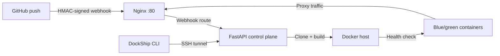

# DockShip

[](https://github.com/RAJPRASHUL/DockShip/actions/workflows/ci.yml)

DockShip is a small self-hosted deployment control plane for trusted GitHub
repositories. It clones an app, builds a Docker image, runs a health gate,
and routes traffic through blue-green releases.

## Architecture


The control plane runs as a host process under systemd because it needs access
to the Docker socket and Nginx configuration. The CI image is a scanned,
versioned artifact in GHCR; production deployment updates the host with SSH.

## Demo

DockShip can demonstrate a safe deployment lifecycle in three steps:

1. **Successful deploy**
   - Edit `APP_VERSION` or the returned text in `examples/hello-app/main.py`.
   - Push the change to its GitHub repository.
   - Open `http://hello.<server-ip>.nip.io` and show the updated response.
2. **Failed deploy**
   - Change `/health` to return HTTP 500 or introduce a bad Dockerfile.
   - Push the change and observe `failed` deployment status.
   - Confirm the existing application URL continues serving the old release.
3. **Rollback**
   - Run `dockship rollback hello`.
   - Wait for the rollback status to become `healthy`.
   - Confirm the previous application version is served again.

Keep a terminal loop running during the successful deploy to verify traffic
continuity:

```bash
while true; do
  curl -s -o /dev/null -w "%{http_code}\n" \
    -H "Host: hello.127.0.0.1.nip.io" http://localhost/
  sleep 0.1
done
```

The loop should continue returning `200` throughout a healthy release switch.
Replace this text with a recorded demo GIF when the environment is available:

```text
docs/demo.gif
```

## Quickstart

Requirements: Python 3.12+, Docker, Nginx, `uv`, and Git.

Create an environment file from the example, then start the API:

```powershell
Copy-Item .env.example .env
uv sync
$env:DOCKSHIP_API_KEY = "local-development-key"
$env:GITHUB_WEBHOOK_SECRET = "local-webhook-secret"
uv run uvicorn dockship.main:app --reload
```

The health endpoint is public and API-key authentication is route-specific:

```text
GET http://localhost:8000/health
GET /apps                  # requires X-API-Key
POST /apps                 # requires X-API-Key
```

All app and deployment APIs require `X-API-Key`. The GitHub webhook uses
`X-Hub-Signature-256` instead.

## CLI

```powershell
uv run dockship login --server http://localhost:8000
uv run dockship register hello https://github.com/example/hello --branch main
uv run dockship deploy hello
uv run dockship logs hello
uv run dockship rollback hello
```

For production, use an SSH tunnel to keep the API private:

```text
ssh -N -L 8000:127.0.0.1:8000 ubuntu@<elastic-ip>
```

Only `/webhook/github` and app virtual hosts are public through Nginx.

## App contract

An application repository must contain a Dockerfile. The image must listen on
the `PORT` environment variable and return HTTP 200 from `/health`.

The example app is in [`examples/hello-app`](examples/hello-app).

## API

| Method | Path | Purpose |
| --- | --- | --- |
| GET | `/health` | Public service health |
| GET/POST | `/apps` | List or register applications |
| POST | `/apps/{name}/deploy` | Queue a deployment |
| POST | `/apps/{name}/rollback` | Queue a rollback |
| GET | `/apps/{name}/logs` | Read active container logs |
| GET | `/deployments/{id}` | Read deployment status |
| POST | `/webhook/github` | Receive signed GitHub pushes |

Webhook payloads require `X-Hub-Signature-256` and delivery IDs are deduplicated
by the SQLite `deliveries` table.

## AWS deployment

Create a budget before provisioning. Run `infra/bootstrap.sh` once, replace
the Terraform backend bucket in `infra/main.tf`, then:

```bash
cd infra
terraform init
terraform plan -var='key_name=<ec2-key-pair>'
terraform apply -var='key_name=<ec2-key-pair>'
```

Destroy temporary environments to avoid ongoing AWS charges:

```bash
terraform destroy -var='key_name=<ec2-key-pair>'
```

Destroying and recreating the instance changes the Elastic IP and therefore
requires updating the GitHub webhook URL.

The EC2 bootstrap:

- creates 2 GB swap for constrained builds;
- installs Docker, Nginx, Git, SQLite, AWS CLI, and fail2ban;
- creates the `dockship` service account;
- disables SSH password authentication;
- enables IMDSv2;
- installs the narrow Nginx/systemd sudoers policy; and
- prepares `/opt/dockship` and `/var/lib/dockship`.

After provisioning, add the GitHub and EC2 secrets listed below before enabling
the production environment.

## GitHub Actions and secrets

The workflow performs linting, tests, a multi-stage Docker build, Trivy
scanning, GHCR publishing, and an SSH host restart for pushes to `main`.

Configure these GitHub repository/environment secrets:

| Secret | Purpose |
| --- | --- |
| `EC2_HOST` | Elastic IP of the DockShip EC2 instance |
| `EC2_SSH_KEY` | Private SSH key for the `dockship` account |
| `GITHUB_TOKEN` | Automatically supplied; used to publish GHCR images |

Branch protection should require the `test` job before merging to `main`.

## Metrics, backups, and security

Metrics and the management API are private and should be reached through the
SSH tunnel. The `/metrics` endpoint exposes deployment counters, deployment
duration, and the active-app gauge.

The instance role can back up SQLite without keys on disk:

```bash
/opt/dockship/deploy/scripts/backup.sh <backup-bucket>
aws s3 cp s3://<backup-bucket>/backups/2026-01-01.db /tmp/restore.db
sqlite3 /var/lib/dockship/dockship.db ".restore /tmp/restore.db"
```

Test a restore before relying on backups. Schedule the backup script at 02:00
and run `deploy/scripts/cleanup.sh` weekly after confirming rollback images
are retained. Deploy only trusted repositories: Dockerfiles execute on the
deployment host. SSH is key-only, the webhook is rate-limited, containers
have CPU/memory/log limits, and the instance uses IMDSv2.
